<p align="center">
  
</p>

<p align="center">
  <b>An agentic travel planner.</b> A team of specialist agents shares one trip plan, uses <b>real</b> places, hotels, flights and live weather,<br>
  and keeps everything inside your budget, with a 3D voice-enabled companion called <b>TRIP</b>.
</p>

<p align="center">
  
  
  
  
  
  
  
  
  
</p>

<p align="center">
  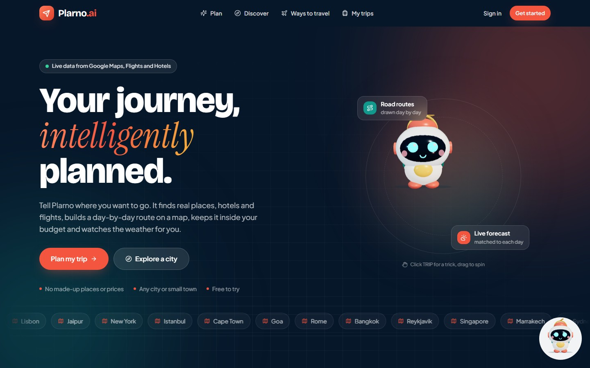
</p>

## Contents
[What it does](#what-it-does) · [Screens](#screens) · [Meet TRIP](#meet-trip) · [How it works](#how-it-works) · [The live guide](#the-live-guide) · [Finding any place, even your college](#finding-any-place-even-your-college) · [Safe by design](#safe-by-design) · [Architecture](#architecture) · [Tech stack](#tech-stack) · [Project structure](#project-structure) · [Getting started](#getting-started) · [Deploy](#deploy) · [API](#api-overview) · [Testing](#testing) · [Demo script](#demo-script) · [Honest limits](#honest-limits) · [Docs](#docs)

---

## What it does

| | |
|---|---|
| 🌍 **Anywhere in the world** | Real attractions, restaurants and hotels for any city or small town (Google Maps and Google Hotels via SerpApi), with ratings, photos, opening hours and nightly rates for *your* dates. |
| ✈️ **Door-to-door travel** | Live Google Flights fares between the nearest airports plus cab, bus and train options, ranked *cheapest / fastest / most comfortable / best value* and split into **within budget** and **stretch**. |
| 🗺️ **Routes that make sense** | Sights are grouped by area, ordered to cut backtracking and drawn on a real road map. Opening hours are respected (closed days are swapped, early closings flagged). |
| 📡 **A live guide, not a static plan** | Weather, air quality, local time, sunrise and a 5-day forecast matched to each trip day, smart tips with one-click fixes, ranked recommendations and a short AI briefing. |
| 💸 **A budget you can trust** | Every number is labelled `live`, `cached`, `estimated` or `simulated`. Go over budget and Plarno re-plans, telling you exactly what it relaxed. |
| 🔁 **Dependency-aware replanning** | Change the hotel and only the agents that depend on it re-run (routes, meals, safety, budget). Change the travel mode and only transport and budget re-run. |
| 🎙️ **Talk to TRIP** | Type or speak. TRIP runs real searches, changes your plan, answers questions from your trip's own data and explains why. |
| 🧭 **Door-to-door routes that exist** | Trains between real major stations with the ride to and from them, buses, cabs and live flights. Each route opens with a map, fares by class, and links to check timings and book. Start from your own location. |
| 🚑 **Essentials and SOS** | Pharmacies, hospitals, groceries, ATMs and police near your stay or near you, with call and directions. A red SOS button sends your live location and your saved emergency contact to a Telegram bot, and shows the local emergency numbers. |
| 🛡️ **You stay in control** | Nothing is booked for you. Agents can only *prepare* and *request approval*; bookings happen on the provider's own site. |

## Screens

<p align="center">
  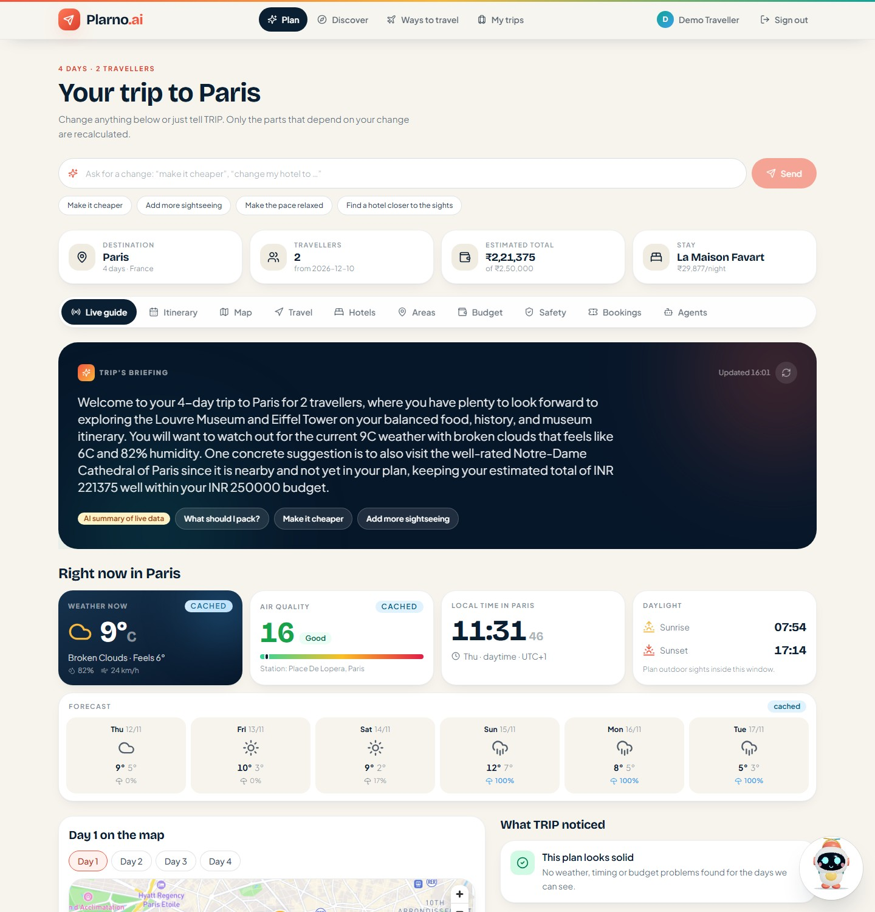<br>
  <sub><b>Live guide.</b> Everything happening at the destination right now, and what it means for <i>this</i> plan.</sub>
</p>

<table>
  <tr>
    <td width="50%">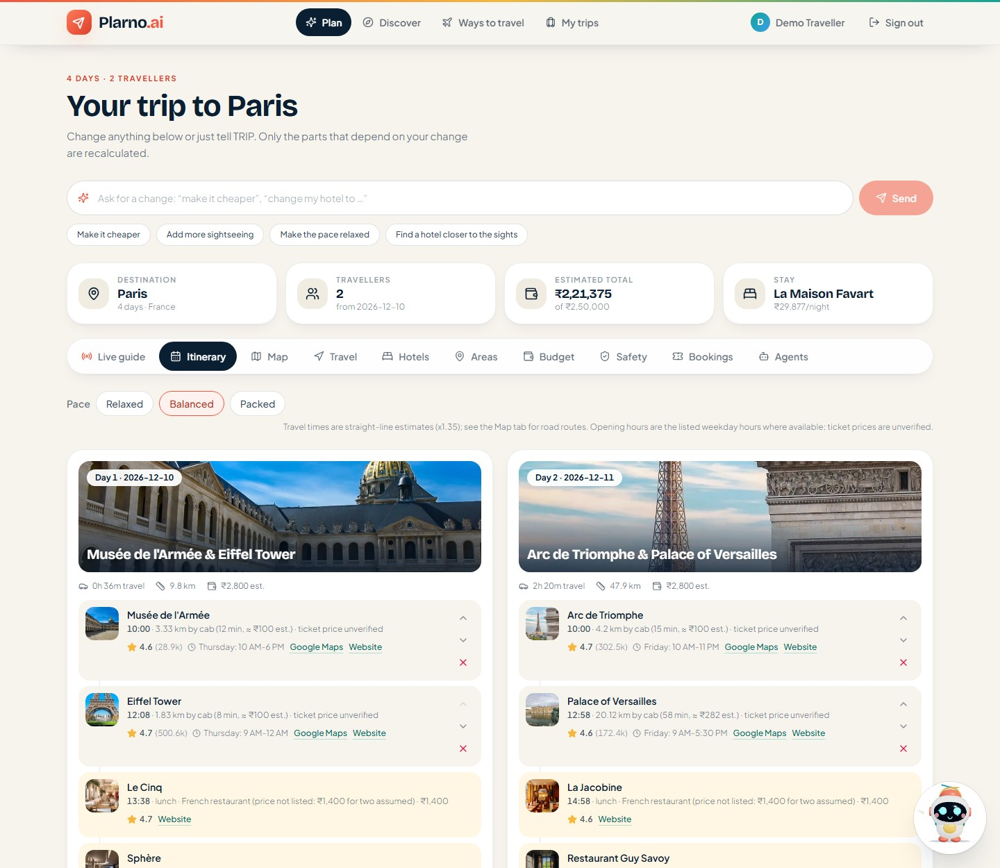<br><sub><b>Itinerary.</b> Reorder, remove or add stops; costs and routes update at once.</sub></td>
    <td width="50%">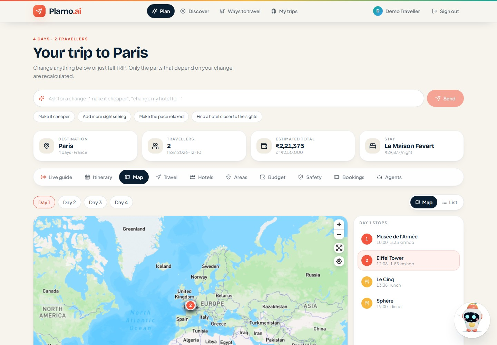<br><sub><b>Map.</b> Real road routes; hover a stop to find its pin.</sub></td>
  </tr>
  <tr>
    <td>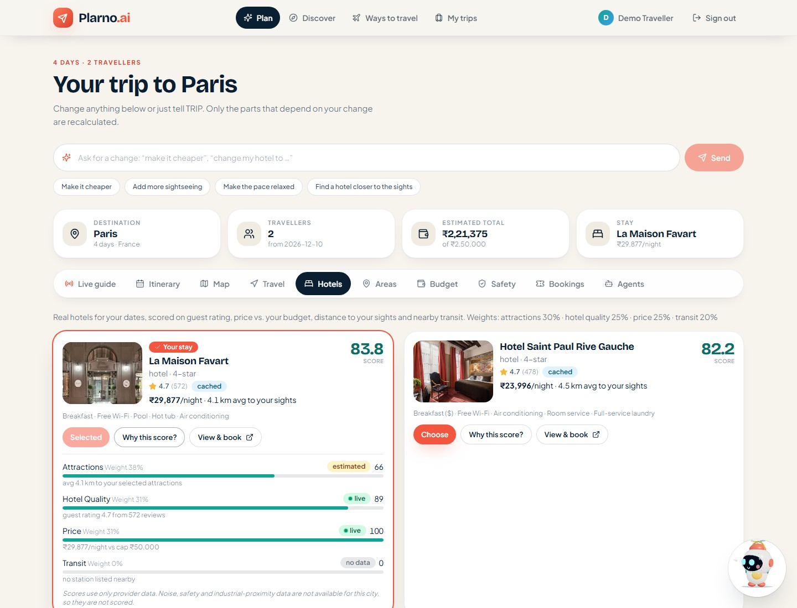<br><sub><b>Hotels.</b> Scored on rating, price, distance to your sights and transit, with the working shown.</sub></td>
    <td>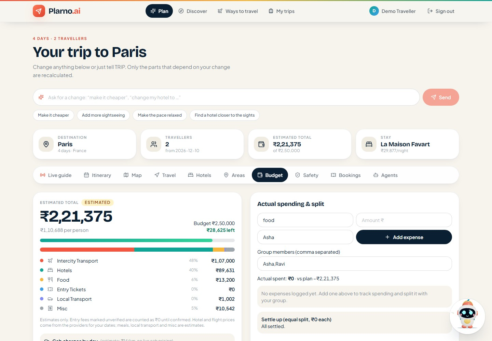<br><sub><b>Budget.</b> Breakdown, per-person cost, daily estimate and expense splitting.</sub></td>
  </tr>
  <tr>
    <td>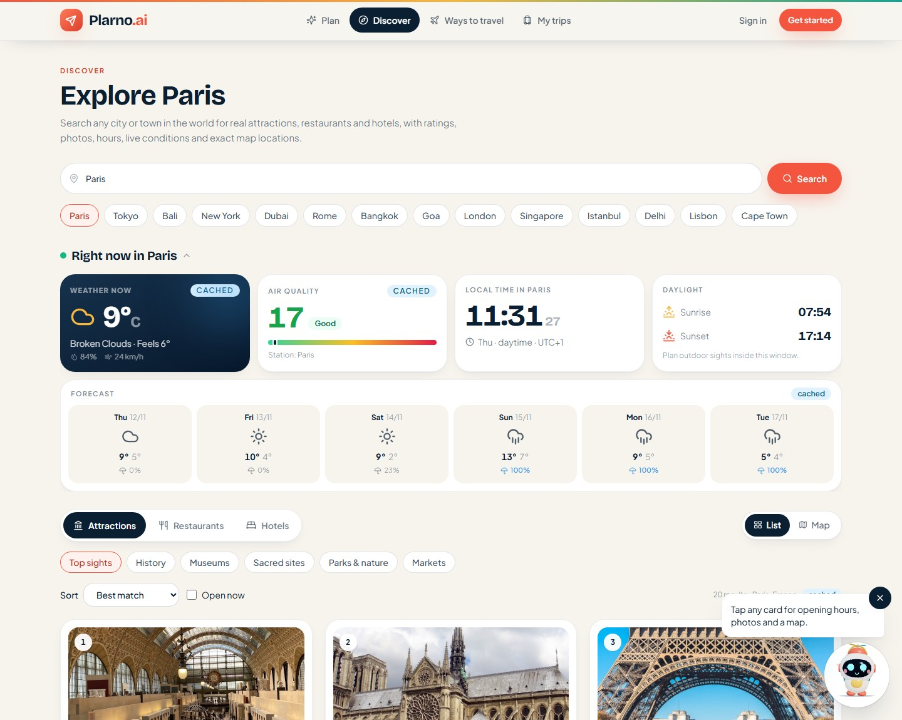<br><sub><b>Discover.</b> Search any city; live conditions, filters, compare and map view.</sub></td>
    <td>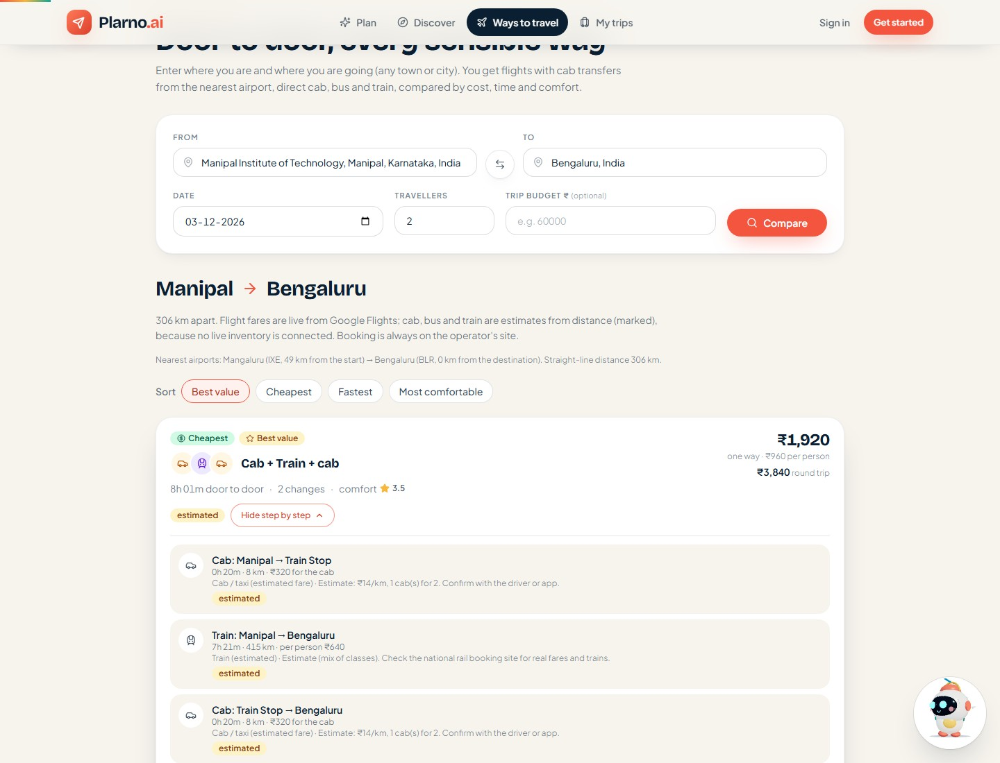<br><sub><b>Ways to travel.</b> Every sensible way from any town, college or station.</sub></td>
  </tr>
  <tr>
    <td>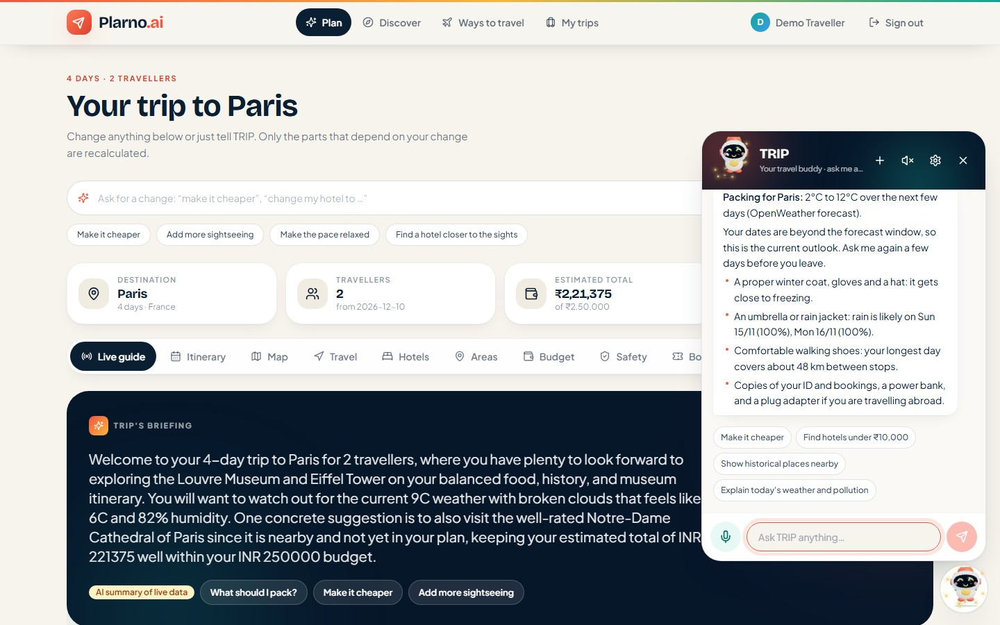<br><sub><b>TRIP chat.</b> “What should I pack?” is answered from the real forecast and your stops.</sub></td>
    <td>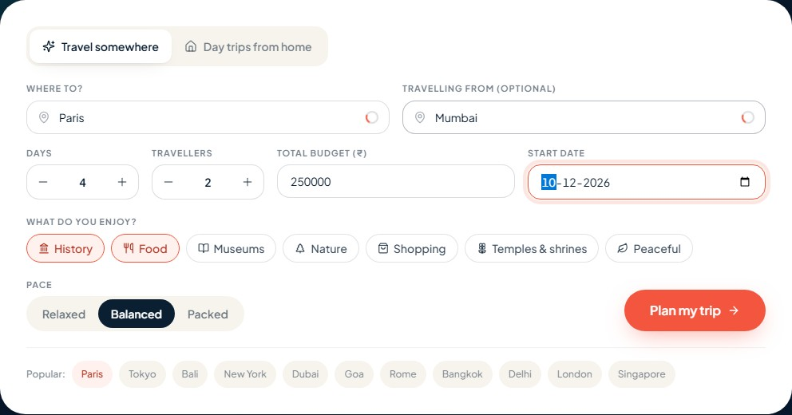<br><sub><b>Trip form.</b> Or skip the form and just tell TRIP in plain language.</sub></td>
  </tr>
</table>

<p align="center">
  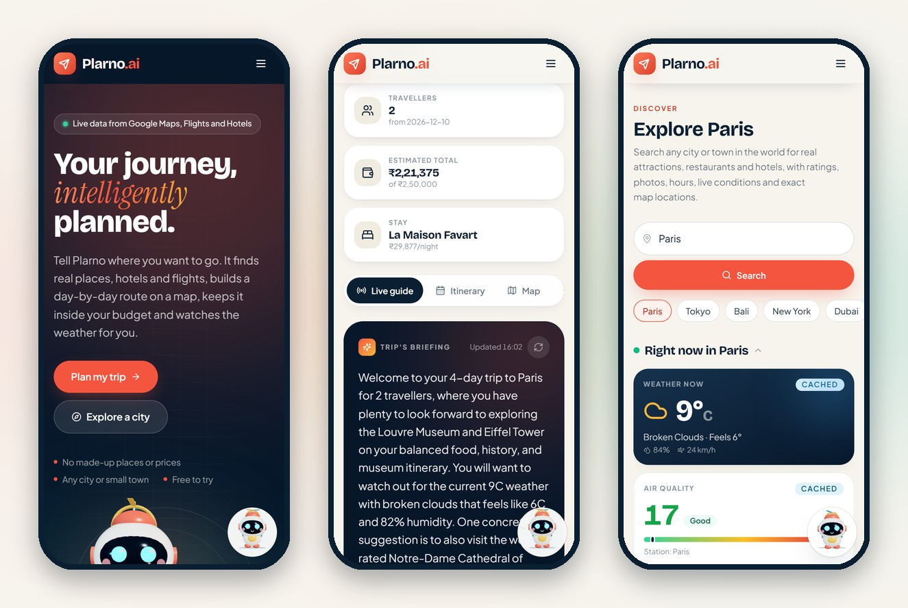<br>
  <sub><b>Built for phones too.</b> No sideways scrolling, large tap targets, and an assistant that fits the screen.</sub>
</p>

## Meet TRIP

<table>
  <tr>
    <td width="240" align="center">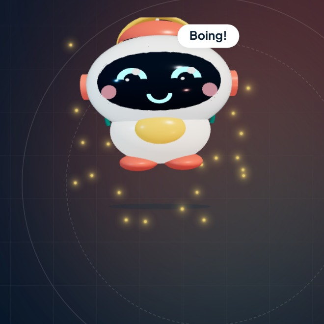</td>
    <td>
TRIP is a real-time 3D companion (React Three Fiber). It is the face of the assistant, and it is meant to be played with:
<ul>
  <li><b>Follows your cursor</b> across the whole page with its head and eyes.</li>
  <li><b>Click it</b> for a trick: jump, spin, wink, dance, a shower of hearts, a nod, peekaboo.</li>
  <li><b>Drag it sideways</b> to turn it around. It carries a little backpack.</li>
  <li><b>Reacts to what is happening:</b> thinks while planning, listens while you speak, celebrates a finished plan, looks worried on errors.</li>
  <li><b>Naps</b> when you leave it alone and wakes with a start when you come back.</li>
  <li>Speaks replies aloud and understands voice in several languages (browser speech APIs).</li>
</ul>
    </td>
  </tr>
</table>

## How it works

**From a sentence to a plan.** Prices, routing, scoring and date logic are plain, testable code. Language models only *understand* and *phrase*; they never produce a price or a place.

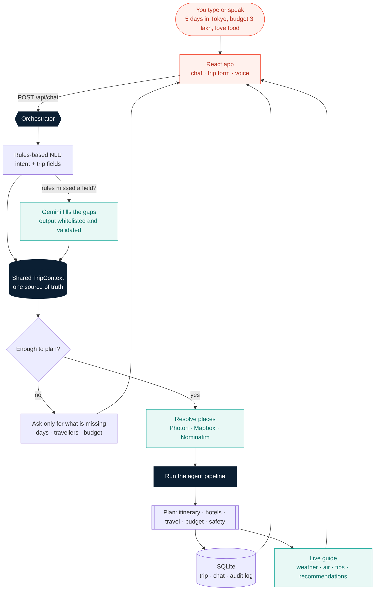

**Replanning only what changed.** The orchestrator knows which agents depend on which, so a small change never recomputes the whole trip.

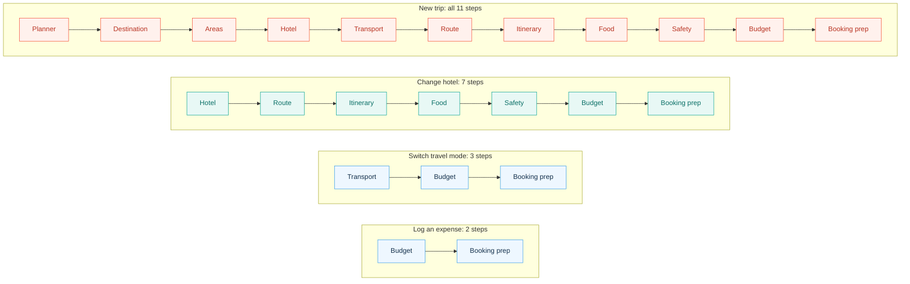

**Over budget?** Plarno relaxes the *travel style* first, then the hotel, and the reply states what changed. A style you chose explicitly (“switch to the fastest option”) is never overridden.

The agents: Travel Orchestrator plus **13 specialists** (Travel Planner, Destination Discovery, Neighbourhood Intelligence, Hotel Intelligence, Transportation, Route Optimization, Itinerary, Food Discovery, Travel Safety, Budget, Booking, Travel Recovery and Travel Companion). Each logs its state, attempts and duration; the **Agents** tab shows the last workflow.

## The live guide

Every planned trip opens on the **Live guide** tab. It answers *“what is happening at my destination, and does it change my plan?”*

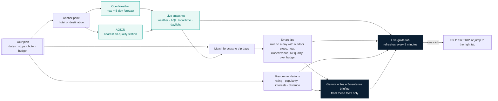

Without provider keys the tiles say what is missing. Nothing is filled in with a guess.

## Finding any place, even your college

Typing `manipal` used to return look-alike villages, because town-only geocoders do not know colleges. Plarno now searches **towns, colleges, stations and airports** at once, understands abbreviations (`iit bombay`, `mit manipal`, `nit trichy`), and hides noise.

<p align="center">
  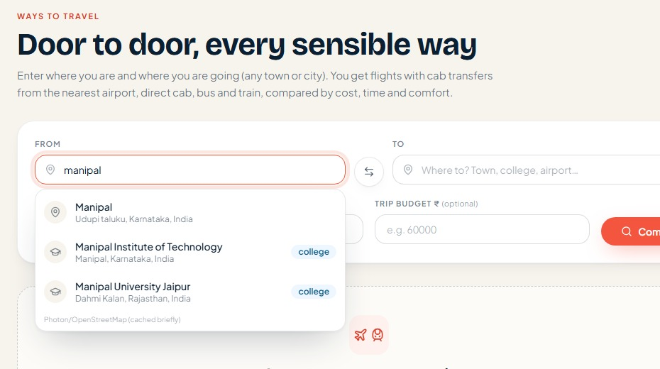
</p>

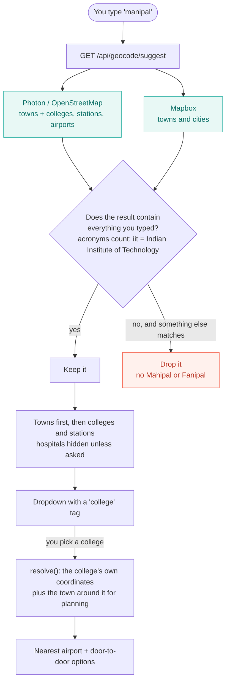

## Safe by design

**The approval gate.** Agents cannot spend money or change a booking on their own.

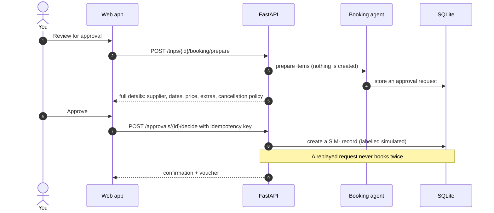

For trips outside the Delhi demo there is nothing to simulate: Plarno uses search-only data sources, so it **never creates reservations or confirmation numbers**. It gives you links to the airline or hotel instead.

**Every number says where it came from.**

| Badge | Meaning |
|---|---|
| 🟢 `live` | Fetched from the provider just now |
| 🔵 `cached` | A recent provider answer, served from cache |
| 🟡 `estimated` | Computed by Plarno (for example cab fare from distance) and marked as an estimate |
| 🟣 `simulated` | Demo data, clearly not real |

## Architecture

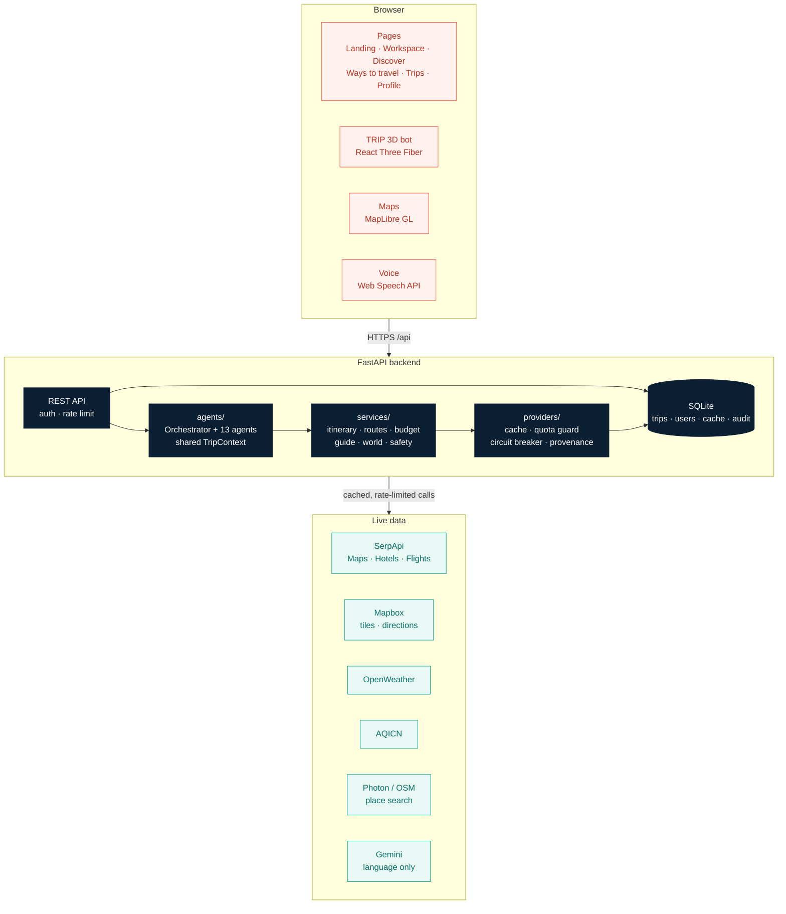

- **Deterministic core, language on top.** `agents/nlu.py` is a rules-based parser; Gemini only fills fields the rules missed (validated against a whitelist), phrases the live briefing from supplied facts, and answers grounded questions. It never invents a price, a place or an opening time.
- **Resilient providers.** Every external call goes through one layer with a persistent cache (stale-if-error), per-provider rate limits, a daily quota guard for the paid key, a circuit breaker and provenance tagging. A dead provider degrades to a labelled fallback instead of breaking a page.
- **Honest failure.** When a provider returns nothing, the UI says so. It does not fabricate.

## Tech stack

| Layer | Technology |
|---|---|
| Frontend | React 18, TypeScript, Vite, Tailwind CSS, Framer Motion, React Router, lucide icons |
| 3D and maps | Three.js with React Three Fiber / drei (the bot), MapLibre GL with Mapbox tiles (maps) |
| Backend | Python 3.11+, FastAPI, Pydantic, httpx, RapidFuzz |
| Storage | SQLite for development; production schema for Postgres + PostGIS + pgvector in [`docs/schema.sql`](docs/schema.sql) |
| Data | SerpApi (Google Maps, Hotels, Flights), Mapbox, OpenWeather, AQICN, Photon / OpenStreetMap |
| Language | Google Gemini (understanding, briefing, grounded Q&A) |
| Quality | pytest (97), Playwright (47 end-to-end checks, plus a click-everything accessibility crawler) |

## Project structure

```text
Plarno.ai/
├── backend/
│   ├── app/
│   │   ├── main.py              REST API (auth, trips, guide, discovery, routes, admin)
│   │   ├── agents/              orchestrator, 13 specialist agents, NLU, tools, shared TripContext
│   │   ├── services/            itinerary, routes, budget, guide, world catalogue, safety, matching, recovery
│   │   ├── providers/           SerpApi, Mapbox, Photon, geocoding, Gemini, caching, rate limits
│   │   └── data/                airports, demo dataset (provenance-tagged)
│   └── tests/                   97 tests with real provider response shapes injected
├── frontend/
│   └── src/
│       ├── pages/               Landing, Workspace, Discover, Transport, Trips, Profile, Auth, Admin
│       └── components/          TripBot (3D), TripAssistant (chat + voice), Guide, Live, ui kit, maps
├── e2e/                         Playwright journey test, click-everything crawler
├── docs/                        INTEGRATIONS.md, STATUS.md, schema.sql, images/
├── INTEGRATION_STATUS.md        what is verified against real providers, and what is not
└── DEVELOPMENT_LOG.md           engineering log: what broke, root cause, fix
```

## Getting started

**Requirements:** Python 3.11+ and Node 20+. Every API key is optional: a missing key disables that provider and the app says so (or falls back to clearly labelled demo data).

```bash
git clone https://github.com/Piyush5525/Plarno.ai.git
cd Plarno.ai

# 1. Configure (optional keys; see the table below)
cp .env.example .env            # Windows: copy .env.example .env

# 2. Backend  ->  http://localhost:8000
cd backend
pip install -r requirements.txt
python -m uvicorn app.main:app --port 8000

# 3. Frontend (new terminal)  ->  http://localhost:5173
cd frontend
npm install
npm run dev
```

Open **http://localhost:5173**, create an account and plan a trip. The first plan for a new city takes up to ~30 seconds (it makes several live searches); repeat requests are served from cache.

<details>
<summary><b>Environment variables</b></summary>

| Variable | Needed for | Notes |
|---|---|---|
| `SERP_API` | Real places, hotels and flight fares | [SerpApi](https://serpapi.com) free plan is quota-limited; Plarno caches for days and enforces a daily cap (`PLARNO_SERP_DAILY_CAP`, default 100) |
| `MAPBOX_API` | Map tiles, road routes, town search | A **public** `pk.` token (the only key sent to the browser) |
| `WEATHER_API` | Live weather and the 5-day forecast | OpenWeather |
| `AQICN_API` | Air quality | AQICN / WAQI |
| `GEMINI_API` | Understanding, the AI briefing, grounded Q&A | Model via `GEMINI_MODEL` (default `gemini-flash-lite-latest`) |
| `TELEGRAM_BOT_TOKEN`, `TELEGRAM_CHAT_ID` | SOS alerts with live location | Bot token from @BotFather and the chat that receives alerts. Without them the SOS dialog still shows emergency numbers |
| `PHOTON_URL` | College / station search | Defaults to the public `photon.komoot.io` (fair use). Self-host for heavy use |
| `PLARNO_SECRET` | Signing session tokens | **Required in production** |
| `PLARNO_ADMIN_EMAILS` | Admin access to supplier tools | Comma-separated emails that register as admin |
| `PLARNO_OFFLINE=1` | Tests | Never calls an external provider |

See [`.env.example`](.env.example) for the full list. `.env` is git-ignored, and `/api/providers/health` and `/api/config` are tested not to leak key values.

Windows PowerShell: `$env:PLARNO_SECRET = python -c "import secrets;print(secrets.token_hex(32))"`
To point the frontend at a backend on another port: `PLARNO_API=http://127.0.0.1:8001 npm run dev`.
Restart `npm run dev` after editing `tailwind.config.js` (Vite does not hot-reload it).
</details>

## API overview

Interactive docs are served by FastAPI at `http://localhost:8000/docs`.

| Endpoint | What it does |
|---|---|
| `POST /api/chat` | Talk to TRIP: plan, change, ask. Returns the reply, the plan and the agent workflow |
| `GET /api/trips/{id}/guide` | The live guide: conditions, forecast per trip day, tips, recommendations, AI briefing |
| `GET /api/live?lat=&lon=` | Live weather, air quality, forecast and local time for any point |
| `POST /api/trips/{id}/itinerary/rebuild` | Add, remove, reorder stops, change hotel or pace; only dependents recompute |
| `GET /api/world/discover` | Real attractions, restaurants or hotels for any city |
| `GET /api/routes/options` | Door-to-door travel options between any two places |
| `GET /api/geocode/suggest` | As-you-type search for towns, colleges, stations and airports |
| `POST /api/trips/{id}/booking/prepare` · `POST /api/approvals/{id}/decide` | The approval gate |
| `POST /api/trips/{id}/recovery/propose` | Disruption handling: what a delay affects and the options |
| `GET /api/providers/health` | Which providers are configured and what their last call did (never returns keys) |

## Deploy

The frontend is a static site (Vercel); the backend is a long-running FastAPI app (Railway). They talk over HTTPS, so each is configured with the other's address.

| Where | Setting | Value |
|---|---|---|
| **Vercel** | Root Directory | `frontend` |
| | Framework preset | Vite · build `npm run build` · output `dist` |
| | Environment variable | `VITE_API_URL` = your Railway address, no trailing slash |
| **Railway** | Root Directory | `backend` |
| | Start command | `uvicorn app.main:app --host 0.0.0.0 --port $PORT --forwarded-allow-ips "*"` (also in `backend/railway.json`) |
| | Volume | mount at `/data`, so accounts and trips survive restarts |
| | Variables | `PLARNO_DB=/data/plarno.db` · `PLARNO_SECRET` (a long random string, **keep it fixed** or everyone is signed out on each restart) · `PLARNO_CORS` = your Vercel address · the API keys from [`.env.example`](.env.example) |

Order: deploy Railway first and copy its address → deploy Vercel with `VITE_API_URL` → set `PLARNO_CORS` on Railway to the Vercel address. Keep Railway at **one replica** (SQLite). A `render.yaml` blueprint is included for Render's free tier, which sleeps when idle and loses its database on restart.
## Testing

```bash
cd backend && python -m pytest -q                      # 97 tests, fully offline

pip install playwright && python -m playwright install chromium
python e2e/site_check.py                               # 47 checks across every page (both servers running)
python e2e/crawl.py                                    # clicks every control on every page, desktop + mobile, and audits accessibility
```

The tests inject real provider response shapes, so they run offline and never spend API quota. The browser suite signs up, plans a trip and exercises every tab, the chat, Discover, travel search, trips, preferences, sign-out and the mobile menu; it fails on any console error, uncaught exception or server error.

## Demo script

1. Register, then use the trip form (or tell TRIP): *“Plan a five-day Delhi trip for two people. Budget ₹30,000 …”*. Add `from Jaipur` to include intercity transport. Or try any city: *“Plan 5 days in Paris from Mumbai, budget ₹250000”*.
2. **Live guide:** read the briefing, check the forecast against your days, and use a tip's one-click fix.
3. **Hotel change:** *“Change my hotel to Old Delhi Haveli Stay”* → routes, meals, safety and budget are recomputed (only the affected agents re-run).
4. **Disruption:** *“My train is delayed by 4 hours”* → affected stops, alternatives with cost and time deltas, and an approval request before anything changes.
5. **Ask:** *“What should I pack?”*, *“Explain today's weather and pollution”*, *“Find restaurants around my hotel”*.
6. **Find your college:** Ways to travel → type `manipal` or `iit bombay` → pick the college → compare options.
7. **Bookings tab:** review → approve (Delhi demo creates `SIM-` records only).
8. Click the bot. Drag it. Leave it alone for 30 seconds.

## Honest limits

This is a prototype, and it says so where it matters.

- **Bus, train and cab prices are estimates** from distance (labelled `estimated`); there is no live railway or bus inventory yet. Flight fares are live.
- **Ticket prices** are not provided by the places data source and are shown as unverified.
- **The Delhi demo** keeps a curated, simulated dataset (neighbourhood scoring, simulated booking flow). Everywhere else uses live data.
- **The airport table** uses city-centre coordinates, so the distance shown is to the airport's city, not the terminal.
- **Place search** uses the public Photon server (no uptime guarantee). If it is down, search falls back to town-only results.
- **Voice** relies on the browser's speech APIs (Chrome or Edge recommended) and was not exercised in the automated tests.
- SQLite and an in-process cache are used for development; see `docs/schema.sql` for the production design.

The full, verified status of every integration is in [INTEGRATION_STATUS.md](INTEGRATION_STATUS.md).

## Docs

- [INTEGRATION_STATUS.md](INTEGRATION_STATUS.md): which providers are verified with real calls, with limits and quotas
- [DEVELOPMENT_LOG.md](DEVELOPMENT_LOG.md): engineering log, bugs found and how each was fixed
- [docs/INTEGRATIONS.md](docs/INTEGRATIONS.md): how to replace each mock with a real provider
- [docs/STATUS.md](docs/STATUS.md): requirement coverage and known gaps
- [docs/schema.sql](docs/schema.sql): production Postgres schema

---

<p align="center">
  <sub>Places and hotels: Google Maps and Google Hotels via SerpApi · Flights: Google Flights via SerpApi · Weather: OpenWeather · Air quality: AQICN · Maps © Mapbox © OpenStreetMap contributors · Place search: Photon (OpenStreetMap, ODbL)</sub><br>
  <sub>Prices are for planning and can change. Always confirm on the provider's site.</sub>
</p>
